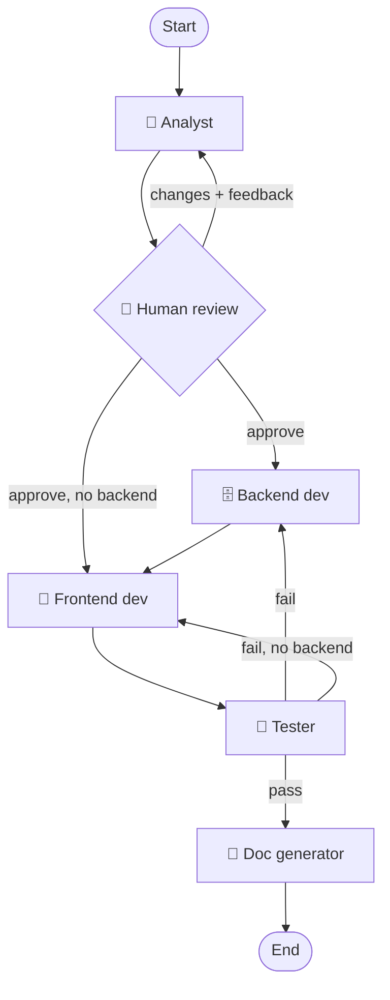

<div align="center">

# 🤖 LangGraph Assistant

**A Dockerized Streamlit app with a web-searching chat agent and a multi-agent software team — powered by LangGraph and Groq.**


</div>

---

## 📖 Table of Contents

- [✨ Features](#-features)
- [🧭 Modes](#-modes)
- [🏗️ Architecture](#️-architecture)
- [🚀 Quick Start](#-quick-start)
- [⚙️ Configuration](#️-configuration)
- [📁 Project Structure](#-project-structure)
- [🧩 Extending](#-extending)
- [🔒 Security Notes](#-security-notes)
- [🛠️ Tech Stack](#️-tech-stack)

## ✨ Features

- 💬 **Chat mode** — conversational agent with memory that searches the web when it isn't sure.
- 👩‍💻 **Developer mode** — a team of AI agents that designs, builds, tests and documents a small web app from a plain-English description.
- 🙋 **Human in the loop** — you approve the analyst's design or send feedback; it revises until you're happy.
- 🔁 **Self-healing builds** — failed tests are sent back to the developers for automatic fix rounds.
- 📊 **Live workflow graph** — the sidebar shows which agent is working right now.
- 📦 **Downloadable output** — every generated project can be downloaded as a zip.
- 🐳 **One-command Docker setup** — Python, Node.js and all dependencies included.

## 🧭 Modes

### 💬 Chat mode

A tool-using agent built with LangGraph. It answers directly when it knows the answer and calls tools when it doesn't.

| Tool | Purpose |
|---|---|
| 🔎 `web_search` | Google results via [Serper](https://serper.dev/) for recent or unknown information |
| 🧮 `calculator` | Safe arithmetic evaluation |
| 🕒 `get_current_time` | Current UTC date and time |

### 👩‍💻 Developer mode

| Step | Agent | What it does |
|---|---|---|
| 1 | 🧠 **Analyst** | Turns your idea into use cases and decides if a backend/database is needed |
| 2 | 🙋 **Human review** | You approve, or give feedback and the analyst revises |
| 3 | 🗄️ **Backend developer** | FastAPI + SQLite (only when the design needs it) |
| 4 | 🎨 **Frontend developer** | Plain JavaScript, HTML and CSS |
| 5 | 🧪 **Tester** | Runs `pytest` and `node` checks in the container; failures loop back to the developers (max 2 rounds) |
| 6 | 📝 **Doc generator** | Full report of what every agent did, plus Netlify deployment suggestions (text only — nothing is deployed) |

## 🏗️ Architecture



## 🚀 Quick Start

### Prerequisites

- 🐳 [Docker](https://docs.docker.com/get-docker/)
- 🔑 A [Groq API key](https://console.groq.com/keys)
- 🔑 A [Serper API key](https://serper.dev/) (optional — needed for web search)

### Run

```bash
git clone https://github.com/Arashomranpour/docker-langgaph-software.git
cd docker-langgaph-software

cp .env.example .env     # add your keys — no quotes around the values

docker build -t langgraph-chat .
docker run -p 8501:8501 --env-file .env -v "$(pwd)/workspace:/app/workspace" langgraph-chat
```

Then open **http://localhost:8501** 🎉

> 💡 The `-v` flag stores generated projects in `./workspace/<project-id>/` on your machine. Without it they disappear when the container stops (you can still use the zip download button).

## ⚙️ Configuration

| Variable | Required | Default | Description |
|---|:---:|---|---|
| `GROQ_API_KEY` | ✅ | — | Groq API key |
| `SERPER_API_KEY` | ⚠️ | — | Enables web search in Chat mode |
| `GROQ_MODEL` | ❌ | `openai/gpt-oss-120b` | Any Groq model that supports tool calling |
| `MAX_FIX_ATTEMPTS` | ❌ | `2` | Tester → developer fix rounds |
| `AGENT_MAX_STEPS` | ❌ | `15` | Max tool-call steps per agent |
| `WORKSPACE_DIR` | ❌ | `./workspace` | Where generated projects are written |

## 📁 Project Structure

```
.
├── app.py                 # Streamlit entry point + mode switch
├── config.py              # Settings from environment variables
├── llm.py                 # Groq model factory
├── workflows/
│   ├── chat.py            # Chat agent graph (LLM ⇄ tools)
│   └── developer.py       # Multi-agent graph with human-in-the-loop
├── agents/
│   ├── base.py            # Reusable tool-calling agent loop
│   ├── analyst.py  backend.py  frontend.py  tester.py  docs.py
├── tools/
│   ├── search.py          # Serper web search
│   ├── utility.py         # Calculator, clock
│   └── workspace.py       # Sandboxed file + shell tools for dev agents
├── ui/
│   ├── chat_view.py       # Chat page
│   ├── developer_view.py  # Progress tracker, expanders, review UI
│   └── graph_view.py      # Live workflow graph (Graphviz)
├── Dockerfile
└── requirements.txt
```

## 🧩 Extending

- ➕ **New tool** — write a function with `@tool` in `tools/` and add it to the agent's tool list.
- 🧑‍🔧 **New agent** — add a file in `agents/` and register a node/edge in `workflows/developer.py`.
- 🔄 **Different model** — set `GROQ_MODEL`, or swap the client in `llm.py`.

## 🔒 Security Notes

- 🔐 API keys are read from the environment and never baked into the image; `.env` is git-ignored and Docker-ignored.
- 🧱 The tester agent may only run `python`, `pytest`, `node` and `pip`, restricted to the project workspace, with a timeout and with API keys stripped from the command's environment. Treat the container as the sandbox and don't expose the app publicly.
- ⏱️ Groq's free tier is rate-limited; long Developer-mode runs may pause on rate-limit errors.

## 🛠️ Tech Stack

[LangGraph](https://langchain-ai.github.io/langgraph/) · [LangChain Groq](https://python.langchain.com/docs/integrations/chat/groq/) · [Streamlit](https://streamlit.io/) · [FastAPI](https://fastapi.tiangolo.com/) · [Serper](https://serper.dev/) · [Docker](https://www.docker.com/)
